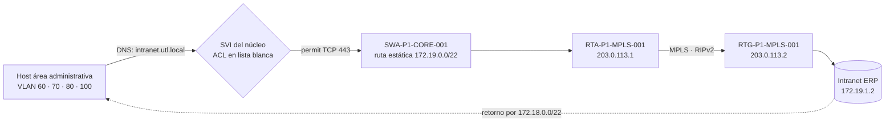

<div align="center">

```
  Lima Este (SJL)                                                        Lima Norte
  172.18.0.0/22  ──►  [ CORE A ]══[ CORE B ]  ──►  [ RTA-MPLS ] ═══ MPLS · RIPv2 ═══ [ RTG-MPLS ]  ──►  Intranet
  Pab. A + Pab. B      Cat 9300X   Cat 9300X        203.0.113.1        203.0.113.0/30      203.0.113.2       172.19.1.2
```

# 🏫 Diseño de Infraestructura de Red y Comunicación

### Nueva sede SJL (Lima Este) de la Universidad Tecnológica de Lima — Cableado estructurado, LAN, WAN, servicios y seguridad

*Proyecto académico — Redes y Comunicación de Datos I · UPC · Grupo 2*

<br/>


[Ver documentación (PDF)](./docs/Documentacion.pdf) · [Ver exposición](./docs/Exposicion_del_proyecto.pptx) · [Abrir simulación en Packet Tracer](./Diseño_de_red.pkt)

</div>

<br/>

## 📌 Tabla de contenido

- [🌐 Sobre el proyecto](#-sobre-el-proyecto)
- [🎯 Situación problemática](#-situación-problemática)
- [✨ Funcionalidades](#-funcionalidades)
- [🧩 Componentes de la solución](#-componentes-de-la-solución)
- [📐 Arquitectura y topología de red](#-arquitectura-y-topología-de-red)
- [🏷️ VLANs y direccionamiento IP](#️-vlans-y-direccionamiento-ip)
- [🌍 Diseño WAN](#-diseño-wan)
- [🔧 Tecnologías utilizadas](#-tecnologías-utilizadas)
- [🚀 Instalación y despliegue](#-instalación-y-despliegue)
- [🔀 Flujo del tráfico](#-flujo-del-tráfico)
- [🔐 Seguridad y control de acceso](#-seguridad-y-control-de-acceso)
- [🛒 Selección de equipos](#-selección-de-equipos)
- [🧪 Validación y resultados](#-validación-y-resultados)
- [📂 Estructura del repositorio](#-estructura-del-repositorio)
- [🧭 Roadmap](#-roadmap)
- [👥 Equipo de desarrollo](#-equipo-de-desarrollo)
- [📄 Licencia y contexto académico](#-licencia-y-contexto-académico)

<br/>

## 🌐 Sobre el proyecto

La **Universidad Tecnológica de Lima (UTL)** está ampliando su oferta académica con una nueva sede en **San Juan de Lurigancho (Lima Este)**, compuesta por **dos pabellones de dos pisos** unidos por fibra óptica. La sede principal, **Lima Norte (Los Olivos)**, aloja la **Intranet institucional**, por lo que ambas sedes deben operar de forma integrada mediante un circuito **MPLS de 150 Mbps** contratado con Claro.

**Diseño de infraestructura de red y comunicación** es la solución propuesta: un diseño integral que abarca desde el **cableado estructurado** (ANSI/TIA-568) hasta la **red lógica** (VLAN, VLSM, enrutamiento inter-VLAN), la **WAN** con Lima Norte (MPLS + RIPv2), los **servicios** (DHCP, DNS, FTP, WiFi e Intranet) y la **seguridad** (ACL extendidas con esquema de lista blanca y NAT/PAT). La solución lógica se implementó y validó en **Cisco Packet Tracer**.

> 💡 Este proyecto forma parte del Trabajo de Investigación del curso **Redes y Comunicación de Datos I** (Programa Académico de EPE, Facultad de Ingeniería de Sistemas — UPC).

### Impacto de la solución

| Dimensión | Aporte |
|---|---|
| 🏗️ **Técnico** | Infraestructura normalizada, segmentada y lista para crecer sin rediseñar el cableado ni el direccionamiento |
| 🔒 **Seguridad** | Lista blanca por área: los datos personales y académicos solo son accesibles para quien los necesita |
| 🤝 **Social e inclusión** | Mismo nivel de servicio en ambos pabellones, cobertura WiFi total y salidas de telecomunicaciones accesibles |
| 💰 **Económico** | Núcleo colapsado y VLSM ajustado a la demanda: menos equipos y mejor aprovechamiento del espacio de direcciones |

<br/>

## 🎯 Situación problemática

| ❌ Riesgos sin diseño previo | ✅ Solución propuesta |
|---|---|
| Distancias de cableado horizontal superiores a 90 m | Un Cuarto de Telecomunicaciones (TR) por piso: 3 TR + 1 Cuarto de Equipos |
| Punto único de falla entre pabellones | Backbone de fibra OM4 con hilos de reserva (usa 4 de 12 hilos) |
| Servicios críticos concentrados sin protección | Cuarto de Equipos dedicado con UPS, climatización, control de acceso y extinción de incendios |
| Falta de etiquetado y administración | Esquema de etiquetado ANSI/TIA-606-B desde la instalación |
| Usuarios heterogéneos en un mismo dominio de broadcast | VLAN por área y tipo de tráfico con enrutamiento inter-VLAN en el núcleo L3 |
| Intranet centralizada en otra sede, sin conexión con la nueva | Enlace WAN MPLS `203.0.113.0/30` con RIPv2 y redistribución de rutas estáticas |
| Asignación manual de IP y servicios dispersos | DHCP con relay, DNS y FTP centralizados en la VLAN 110 |
| Exposición de servicios y acceso no autorizado entre áreas | ACL extendidas en las SVI del núcleo y NAT/PAT solo para subredes autorizadas |

<br/>

## ✨ Funcionalidades

<table>
<tr>
<td width="50%" valign="top">

### 🔌 Infraestructura y red
- **237 enlaces horizontales** UTP Cat 6A (118 en Pab. A · 119 en Pab. B)
- Backbone de fibra **OM4**: 3 troncales, 6 cables, 72 hilos
- Núcleo colapsado: **1 switch L3 por pabellón** + 12 switches de acceso
- **EtherChannel** (PAgP) entre núcleo y acceso
- **VLSM** sobre `172.18.0.0/22`, sumarizable en una sola ruta
- WAN **MPLS** con **RIPv2** (`no auto-summary`, interfaz LAN pasiva)

</td>
<td width="50%" valign="top">

### 🛡️ Servicios y seguridad
- **DHCP** con relay (`ip helper-address`) · 18 pools
- **DNS** interno (`ftp.utl.local`, `intranet.utl.local`)
- **FTP** restringido a áreas administrativas
- **WiFi** en 18 ambientes con WPA2-AES y VLAN propia
- **Intranet (ERP)** por HTTPS, sin exposición a Internet
- **ACL** en lista blanca + **NAT/PAT** controlado

</td>
</tr>
</table>

<br/>

## 🧩 Componentes de la solución

```
FASE 1 · DIAGNÓSTICO
 ├── 1. Contexto, áreas y usuarios de la sede (237 puntos de red)
 └── 2. Deficiencias, premisas y criterios de diseño
       │
       ▼
FASE 2 · CABLEADO ESTRUCTURADO
 ├── 3. Cuarto de Equipos (MDF) + 3 TR de piso
 ├── 4. Backbone de fibra OM4 (E1 · E2 · E3)
 └── 5. Cableado horizontal UTP Cat 6A y canalizaciones (relleno máx. 25%)
       │
       ▼
FASE 3 · RED LÓGICA
 ├── 6. LAN: núcleo colapsado, VLAN y VLSM
 └── 7. WAN: MPLS con RIPv2 hacia Lima Norte
       │
       ▼
FASE 4 · SERVICIOS Y SEGURIDAD
 ├── 8. DHCP · DNS · FTP · WiFi · Intranet
 ├── 9. ACL extendidas + NAT/PAT
 └── 10. Validación en Cisco Packet Tracer
```

| # | Fase | Descripción breve | Elemento clave |
|---|---|---|---|
| 1 | **Diagnóstico** | Define áreas, usuarios y premisas de diseño | ANSI/TIA-568.1 |
| 2 | **Cableado estructurado** | Espacios técnicos, backbone, horizontal y canalizaciones | UTP Cat 6A · Fibra OM4 |
| 3 | **LAN** | Núcleo colapsado con SVI como gateway de cada VLAN | Catalyst 9300X · 9200L |
| 4 | **Direccionamiento** | Un /23 por pabellón, VLSM por VLAN y enlaces /30 | `172.18.0.0/22` |
| 5 | **WAN** | Enlace punto a punto con la sede principal | MPLS · RIPv2 |
| 6 | **Servicios internos** | Configuración automática y resolución de nombres | DHCP · DNS · FTP · WiFi |
| 7 | **Servicio publicado** | Acceso a la Intranet de Lima Norte por circuito privado | HTTPS (TCP 443) |
| 8 | **Seguridad** | Lista blanca por área y traducción controlada | ACL · NAT/PAT |
| 9 | **Validación** | Pruebas de enlace, servicios y bloqueo por ACL | Packet Tracer |

<br/>

## 📐 Arquitectura y topología de red

```
 ┌──────────────────────── SEDE LIMA ESTE (SJL) ────────────────────────┐         ┌──── SEDE LIMA NORTE ────┐
 │                                                                      │         │                         │
 │  PABELLÓN A                              PABELLÓN B                  │         │                         │
 │  ┌─────────────────────┐                 ┌─────────────────────┐     │         │                         │
 │  │ ER · TR-101A        │                 │ TR-101B             │     │         │                         │
 │  │ SWA-P1-CORE-001     │═ Po48 · /30 ═══►│ SWB-P1-CORE-001     │     │         │                         │
 │  │ + 4 SW L2           │ 172.18.1.128/30 │ + 4 SW L2           │     │         │                         │
 │  │ Servidores VLAN 110 │                 └──────────┬──────────┘     │         │                         │
 │  └───┬─────────┬───────┘                            │ E3 (fibra)     │         │                         │
 │      │ E1      │                         ┌──────────▼──────────┐     │         │                         │
 │  ┌───▼───────┐ │                         │ TR-201B · 2 SW L2   │     │         │                         │
 │  │ TR-201A   │ │                         └─────────────────────┘     │         │                         │
 │  │ 2 SW L2   │ │                                                     │         │                         │
 │  └───────────┘ ├──► RTA-P1-INTERNET-001 ──► Internet (NAT/PAT)       │         │                         │
 │                └──► RTA-P1-MPLS-001 ═══════ MPLS 203.0.113.0/30 ═════╪═════════╪══► RTG-P1-MPLS-001      │
 │                                                                      │         │       │                 │
 └──────────────────────────────────────────────────────────────────────┘         │  SRVG-P1-INTRANET       │
                                                                                   │      172.19.1.2         │
                                                                                   └─────────────────────────┘
```

| Capa | Equipos | Función | Ubicación |
|---|---|---|---|
| **Núcleo / distribución (colapsada)** | `SWA-P1-CORE-001` · `SWB-P1-CORE-001` | Inter-VLAN (SVI), gateway, relay DHCP, ACL y enlace L3 entre pabellones | ER TR-101A · TR-101B |
| **Acceso** | 12 switches de capa 2 | Usuarios, AP, telefonía IP y cámaras · trunks 802.1Q | TR-101A · TR-201A · TR-101B · TR-201B |
| **Servicios** | `SRVA-P1-DHCP-001` · `SRVA-P1-DNS-001` · `SRVA-P1-FTP-001` | DHCP, DNS y FTP | ER TR-101A (VLAN 110) |
| **Borde** | `RTA-P1-INTERNET-001` · `RTA-P1-MPLS-001` | Internet con NAT/PAT y enlace MPLS con Lima Norte | ER TR-101A |

### Cableado estructurado

| Elemento | Medio | Detalle |
|---|---|---|
| **Backbone E1** | Fibra OM4 | ER (Pab. A) → TR-201A |
| **Backbone E2** | Fibra OM4 | ER (Pab. A) → TR-101B, por ducto subterráneo entre pabellones |
| **Backbone E3** | Fibra OM4 | TR-101B → TR-201B |
| **Horizontal** | UTP Cat 6A | 237 enlaces · permanente ≤ 90 m · canal ≤ 100 m · PoE+/PoE++ |
| **Canalización** | Bandeja, EMT y ducto PVC | Factor de relleno máximo del 25% |

> Cada troncal usa 2 enlaces verticales de 12 hilos (uno activo y otro de redundancia): **6 cables · 72 hilos**, de los cuales 24 se usan de forma activa.

<br/>

## 🏷️ VLANs y direccionamiento IP

El bloque privado `172.18.0.0/22` se divide en un **/23 por pabellón** y cada /23 se subdivide con **VLSM** ordenando de mayor a menor. Las VLAN usan los mismos identificadores en ambos pabellones, pero con subredes distintas (no se extienden entre edificios).

| Nivel | Bloque | Uso |
|---|---|---|
| **Sede Lima Este** | `172.18.0.0/22` | Ruta sumarizada anunciada a la WAN |
| **Pabellón A** | `172.18.0.0/23` | 11 VLAN y 3 enlaces /30 |
| **Pabellón B** | `172.18.2.0/23` | 10 VLAN |
| **Sede Lima Norte** | `172.19.0.0/23` | Red remota (Intranet `172.19.1.2`) |
| **Enlace WAN MPLS** | `203.0.113.0/30` | Segmento entre routers MPLS |

### Pabellón A — `172.18.0.0/23`

| VLAN | Nombre | Subred | Gateway | Tipo |
|---|---|---|---|---|
| 40 | Wireless-PAB-A | `172.18.0.0/25` | `172.18.0.1` | Inalámbrico |
| 20 | LAB-101A | `172.18.0.128/26` | `172.18.0.129` | Datos |
| 30 | Voice-PAB-A | `172.18.0.192/26` | `172.18.0.193` | Voz |
| 90 | Aulas-PAB-A | `172.18.1.0/28` | `172.18.1.1` | Datos |
| 50 | CCTV-PAB-A | `172.18.1.16/28` | `172.18.1.17` | Video |
| 60 | OTI | `172.18.1.32/28` | `172.18.1.33` | Administrativa |
| 70 | RACAD | `172.18.1.48/28` | `172.18.1.49` | Administrativa |
| 80 | RRHH | `172.18.1.64/28` | `172.18.1.65` | Administrativa |
| 100 | ESCSIST | `172.18.1.80/28` | `172.18.1.81` | Administrativa |
| 10 | MGMT-PAB-A | `172.18.1.96/28` | `172.18.1.97` | Gestión |
| 110 | Servidores | `172.18.1.112/29` | `172.18.1.113` | Servicios |

### Pabellón B — `172.18.2.0/23`

| VLAN | Nombre | Subred | Gateway | Tipo |
|---|---|---|---|---|
| 40 | Wireless-PAB-B | `172.18.2.0/25` | `172.18.2.1` | Inalámbrico |
| 20 | LAB-101B | `172.18.2.128/26` | `172.18.2.129` | Datos |
| 30 | Voice-PAB-B | `172.18.2.192/26` | `172.18.2.193` | Voz |
| 90 | Aulas-PAB-B | `172.18.3.0/28` | `172.18.3.1` | Datos |
| 50 | CCTV-PAB-B | `172.18.3.16/28` | `172.18.3.17` | Video |
| 60 | Finanzas | `172.18.3.32/28` | `172.18.3.33` | Administrativa |
| 70 | Admision | `172.18.3.48/28` | `172.18.3.49` | Administrativa |
| 80 | BIU | `172.18.3.64/28` | `172.18.3.65` | Administrativa |
| 100 | Direccion-General | `172.18.3.80/28` | `172.18.3.81` | Administrativa |
| 10 | MGMT-PAB-B | `172.18.3.96/28` | `172.18.3.97` | Gestión |

### Direcciones estáticas de infraestructura

| Equipo / interfaz | Dirección IP | Subred | Observación |
|---|---|---|---|
| `SWA-P1-CORE-001` ↔ `SWB-P1-CORE-001` | `.129` / `.130` | `172.18.1.128/30` | Enlace L3 inter-pabellón (Po48, fibra OM4) |
| `SWA-P1-CORE-001` ↔ `RTA-P1-INTERNET-001` | `.121` / `.122` | `172.18.1.120/30` | Salida a Internet (NAT/PAT) |
| `SWA-P1-CORE-001` ↔ `RTA-P1-MPLS-001` | `.125` / `.126` | `172.18.1.124/30` | Salida a la WAN MPLS |
| `SRVA-P1-DHCP-001` | `172.18.1.114` | `172.18.1.112/29` | Servidor DHCP |
| `SRVA-P1-DNS-001` | `172.18.1.115` | `172.18.1.112/29` | Servidor DNS |
| `SRVA-P1-FTP-001` | `172.18.1.116` | `172.18.1.112/29` | Servidor FTP |

<br/>

## 🌍 Diseño WAN

| Parámetro | Valor |
|---|---|
| Segmento WAN | `203.0.113.0/30` (RFC 5737 · TEST-NET-3) |
| `RTA-P1-MPLS-001` · Se0/1/0 (DTE) | `203.0.113.1` — Lima Este |
| `RTG-P1-MPLS-001` · Se0/1/0 (DCE) | `203.0.113.2` — Lima Norte (`clock rate 2000000`) |
| Interfaz LAN de `RTA-P1-MPLS-001` | `172.18.1.126/30` → CORE-A `Gi1/0/26` (`.125`) |
| Interfaz LAN de `RTG-P1-MPLS-001` | `172.19.1.10/30` → siguiente salto `172.19.1.9` |
| Protocolo | **RIPv2** · distancia administrativa 120 · multicast `224.0.0.9` |
| Redes anunciadas | `172.18.0.0/22` (Lima Este) · `172.19.0.0/23` (Lima Norte) |

```
! RTA-P1-MPLS-001 (Lima Este)
interface Serial0/1/0
 ip address 203.0.113.1 255.255.255.252
 bandwidth 2000
 no shutdown
ip route 172.18.0.0 255.255.252.0 172.18.1.125
router rip
 version 2
 no auto-summary
 network 172.18.0.0
 network 203.0.113.0
 passive-interface GigabitEthernet0/0/0
 redistribute static metric 1
```

> 💡 RIPv2 se ejecuta **solo en el segmento WAN**. Dentro de la sede se usan rutas estáticas porque la topología interna tiene un único camino entre cada par de equipos.

### ¿Por qué RIPv2?

| Criterio | **RIPv2** ★ | OSPF | EIGRP |
|---|---|---|---|
| Algoritmo | Bellman-Ford | Dijkstra (SPF) | DUAL |
| Distancia administrativa | 120 | 110 | 90 |
| Convergencia | Lenta | Rápida | Muy rápida |
| Estándar | Abierto (RFC 2453) | Abierto (RFC 2328) | Propietario Cisco |
| Complejidad | Baja | Media (áreas) | Media |

> ★ **Seleccionado:** RIPv2 — para dos sedes separadas por un salto, es suficiente, soporta VLSM y funciona con equipos de cualquier fabricante.

<br/>

## 🔧 Tecnologías utilizadas

<div align="center">


</div>

| Herramienta / estándar | Uso en el proyecto |
|---|---|
| **Cisco Packet Tracer** | Implementación y validación de la solución lógica |
| **Cisco Catalyst 9300X / 9200L** | Switches de núcleo (L3) y de acceso (L2) con IOS XE |
| **ANSI/TIA-568.0-D · 568.1** | Cableado genérico y de edificios comerciales y campus |
| **ANSI/TIA-569** | Espacios y canalizaciones de telecomunicaciones |
| **ANSI/TIA-606-B** | Administración y etiquetado de la infraestructura |
| **IEEE 802.1Q · 802.3at** | Troncales VLAN y PoE+ |
| **VLSM · RFC 1918** | Direccionamiento privado jerárquico |
| **RIPv2 · NAT/PAT · ACL** | Enrutamiento WAN, traducción de direcciones y control de acceso |

<br/>

## 🚀 Instalación y despliegue

### Requisitos previos
- **Cisco Packet Tracer** (para abrir `Diseño_de_red.pkt`)
- Un visor de **PDF** y de **PowerPoint** para la documentación y la exposición

### Pasos

```bash
# 1. Clonar el repositorio
git clone https://github.com/<usuario>/<repositorio>.git

# 2. Ingresar a la carpeta del proyecto
cd <repositorio>

# 3. Abrir la simulación en Cisco Packet Tracer
#    Archivo → Abrir → Diseño_de_red.pkt
```

### ✅ Verificación

```text
! EtherChannel núcleo–acceso (Po1–Po6 en estado SU, puertos miembro en P)
show etherchannel summary

! Rutas aprendidas por RIPv2
show ip route rip
show ip protocols

! ACL aplicadas y contadores
show access-lists
show ip interface vlan <id>

! Traducciones NAT/PAT (en RTA-P1-INTERNET-001)
show ip nat translations
```

Desde un equipo de un área administrativa, probar en el navegador:

```text
https://intranet.utl.local      → Portal Administrativo (ERP) de Lima Norte
https://www.buscanet.test       → Internet simulado
ftp 172.18.1.116                → Servidor FTP (usuario rrhh)
```

### 🌐 Servicios de referencia

| Servicio | Host / nombre | Dirección | Puerto |
|---|---|---|---|
| DHCP | `SRVA-P1-DHCP-001` | `172.18.1.114` | UDP 67 |
| DNS | `SRVA-P1-DNS-001` | `172.18.1.115` | TCP/UDP 53 |
| FTP | `ftp.utl.local` | `172.18.1.116` | TCP 21 / 20 |
| Intranet (ERP) | `intranet.utl.local` | `172.19.1.2` | TCP 443 |

<br/>

## 🔀 Flujo del tráfico



**Pasos del acceso a la Intranet:** el usuario consulta `intranet.utl.local` y el DNS devuelve `172.19.1.2`; la ACL de su VLAN verifica que el área esté autorizada para HTTPS; en el Pabellón B el tráfico cruza el enlace `172.18.1.128/30` hacia el núcleo A; este lo envía a `RTA-P1-MPLS-001`, que lo reenvía por `203.0.113.0/30`; `RTG-P1-MPLS-001` lo entrega al servidor y la respuesta regresa por la ruta `172.18.0.0/22` anunciada por Lima Este.

<br/>

## 🔐 Seguridad y control de acceso

La seguridad sigue un esquema de **lista blanca**: por defecto ninguna VLAN puede comunicarse con otra y solo se permite el tráfico que cada área necesita.

### Matriz de acceso por grupo de VLAN

| Grupo de VLAN | DHCP / DNS | FTP | Intranet | Internet | Otras VLAN |
|---|:---:|:---:|:---:|:---:|:---:|
| Administrativas Pab. A (60, 70, 80, 100) | ✅ | ✅ | ✅ | ✅ | ❌ |
| Administrativas Pab. B (60, 70, 80, 100) | ✅ | ✅ | ✅ | ✅ | ❌ |
| Laboratorios (20) | ✅ | ❌ | ❌ | ✅ | ❌ |
| Aulas (90) | ✅ | ❌ | ❌ | ✅ | ❌ |
| WiFi (40) | ✅ | ❌ | ❌ | ✅ | ❌ |
| Voz (30) | ✅ | ❌ | ❌ | ❌ | ❌ |
| CCTV (50) | ✅ | ❌ | ❌ | ❌ | ❌ |
| Gestión (10) | ✅ | ❌ | ❌ | ❌ | ❌ |
| Servidores (110) | Solo respuestas | ❌ | ❌ | ❌ | Solo respuestas |

### ACL y NAT configurados

| ACL | Equipo | Aplicación | Función |
|---|---|---|---|
| `PAB-A` | `SWA-P1-CORE-001` | SVI VLAN 10 a 100 (in) | Lista blanca de los usuarios del Pabellón A |
| `Servidores` | `SWA-P1-CORE-001` | SVI VLAN 110 (in) | Permite solo respuestas de los servidores |
| `PAB-B` | `SWB-P1-CORE-001` | SVI VLAN 10 a 100 (in) | Lista blanca de los usuarios del Pabellón B |
| `ACL-INTERNET` | `RTA-P1-INTERNET-001` | `ip nat inside source list` | Define qué subredes se traducen con NAT/PAT |

### Reglas y políticas destacadas

- 🧱 Cada ACL se evalúa de arriba hacia abajo y **termina con `deny ip any any`** explícito.
- 🚧 Las ACL de usuarios se aplican **en sentido de entrada** en las SVI, lo más cerca posible del origen.
- 🔒 Se bloquea el tráfico hacia redes privadas **RFC 1918** para aislar las VLAN entre sí.
- 🚫 **Voz, CCTV, gestión y servidores no tienen salida a Internet** ni a la red MPLS.
- 🖥️ Los **servidores son pasivos**: solo responden, no pueden iniciar conexiones (ACL `Servidores`).
- 🌐 **NAT/PAT solo para subredes autorizadas**: `ACL-INTERNET` es la segunda línea de defensa.
- 🏢 La **Intranet no se publica en Internet**: solo es alcanzable desde `172.18.0.0/22` y `172.19.0.0/23`.
- 🛑 **No se implementa DMZ** porque ningún servicio se publica hacia Internet; se recomienda crearla detrás de un firewall si esto cambia.

<br/>

## 🛒 Selección de equipos

| Criterio de selección |
|---|
| Vigencia comercial y de soporte · PoE para dispositivos finales · compatibilidad con fibra OM4 · capacidad de crecimiento · operación con Cisco IOS XE |

| Característica | Switch de acceso (L2) | Switch de núcleo (L3) |
|---|---|---|
| **Modelo** | Cisco Catalyst `C9200L-24P-4X` | Cisco Catalyst `C9300X-24Y` |
| **Puertos** | 24 × 1 GbE PoE+ | 24 × 1/10/25G SFP28 |
| **Uplinks** | 4 × 10G SFP+ | Módulo de red modular, hasta 100G |
| **Crecimiento** | StackWise-80 | StackWise-1T |
| **Cantidad** | 12 unidades | 2 unidades |

| Cuarto técnico | Núcleo | Acceso | Otros equipos |
|---|:---:|:---:|---|
| ER · TR-101A (Pab. A, piso 1) | 1 | 4 | Servidores DHCP, DNS y FTP · routers del proveedor |
| TR-201A (Pab. A, piso 2) | — | 2 | — |
| TR-101B (Pab. B, piso 1) | 1 | 4 | — |
| TR-201B (Pab. B, piso 2) | — | 2 | — |
| **Total** | **2** | **12** | |

> ⚠️ Se evitó la serie Catalyst 2960-X: Cisco dejó de venderla el 31/10/2022 y termina su soporte el 31/10/2027; su reemplazo oficial es la serie 9200L. Los routers de borde son CPE administrados por Claro y no forman parte de la adquisición.

<br/>

## 🧪 Validación y resultados

| # | Prueba | Origen / comando | Resultado esperado | Resultado |
|---|---|---|---|---|
| 1 | EtherChannel núcleo–acceso | `show etherchannel summary` | Po1–Po6 en estado `SU`, puertos en `P` (PAgP desirable) | ✅ Conforme |
| 2 | Descarga de archivo por FTP | PC de RRHH → `ftp 172.18.1.116` | Autenticación correcta y transferencia del archivo | ✅ Conforme |
| 3 | Acceso a Internet con NAT/PAT | `https://www.buscanet.test` | Carga del buscador simulado | ✅ Conforme |
| 4 | Acceso a la Intranet (ERP) por MPLS | `https://intranet.utl.local` | Carga del Portal Administrativo de Lima Norte | ✅ Conforme |
| 5 | Bloqueo por ACL | Host de laboratorio o aula → FTP / Intranet | Conexión rechazada por la ACL de la SVI | ✅ Conforme |

**Análisis:** los seis Port-channel agrupan correctamente sus enlaces; la descarga por FTP confirma la conectividad entre VLAN administrativas y la VLAN 110; el acceso a Internet valida la ruta por defecto y el NAT/PAT; la Intranet valida DNS, ruta estática, RIPv2 y el retorno redistribuido; y la prueba negativa desde `LAB101A` confirma que la lista blanca funciona.

<br/>

## 📂 Estructura del repositorio

```
├── README.md
├── Diseño_de_red.pkt                  → Simulación en Cisco Packet Tracer
└── docs/
    ├── Documentacion.pdf              → Trabajo de investigación completo (89 páginas)
    └── Exposicion_del_proyecto.pptx   → Presentación del proyecto
```

La documentación se organiza en los siguientes capítulos:

```
├── 1) Contexto y diagnóstico general
├── 2) Diseño del sistema de cableado estructurado
│   ├── Diagrama de arquitectura · memorias descriptivas y de cálculo
│   └── Especificaciones técnicas y estándares aplicados
├── 3) Diseño de topología LAN
│   └── Modelo lógico · VLAN · plan de direccionamiento IP
├── 4) Diseño de topología WAN
│   └── Direccionamiento · RIPv2 · justificación técnica
├── 5) Servicios internos de red (DHCP · DNS · WiFi · FTP)
├── 6) Servicios publicados (Intranet)
├── 7) Seguridad y control de acceso (ACL · NAT · DMZ)
├── 8) Selección de equipos de red
├── 9) Validación y resultados
└── Conclusiones · Recomendaciones · Glosario · Bibliografía · Anexos (planos)
```

<br/>

## 🧭 Roadmap

- [ ] Incorporar **alta disponibilidad en el núcleo** (segundo C9300X en stack o HSRP)
- [ ] Añadir un **firewall perimetral** de nueva generación y **autenticación 802.1X** en puertos de acceso; usar SSH y *port security* en la gestión
- [ ] **Certificar el cableado** instalado (Clase EA para cobre y OTDR para fibra) antes de la puesta en marcha
- [ ] Evaluar la **migración a OSPF** si la red crece y activar la autenticación **MD5** de RIPv2 mientras tanto
- [ ] Implementar **monitoreo y respaldo de configuraciones** (SNMP, Syslog, NTP)
- [ ] Validar que el **PoE+** cubre los access points elegidos y mantener actualizado el etiquetado TIA-606-B

<br/>

## 👥 Equipo de desarrollo

<div align="center">

| Integrante |
|---|
| Alberca Munive, Luis Enrico |
| Arévalo Villano, Jaime Manuel |
| Imán Juárez, Juan Diego |
| Hamacto Guadalupe, Moisés |
| Paredes Pari, Walinn |

**Tutor:** Rivas Galloso, Paul Harris

*Lima, 14 de octubre de 2026*

</div>

<br/>

## 📄 Licencia y contexto académico

Este proyecto fue desarrollado con **fines académicos e informativos** para el curso **Redes y Comunicación de Datos I (Grupo 2)**, Facultad de Ingeniería de Sistemas, Programa Académico de EPE — **Universidad Peruana de Ciencias Aplicadas (UPC)**. La Universidad Tecnológica de Lima corresponde a un caso de estudio planteado para el curso.

<div align="center">

🌐🏫 *Hecho con Cisco Packet Tracer, VLSM y mucho café por el equipo del Grupo 2* 🔌

</div>
